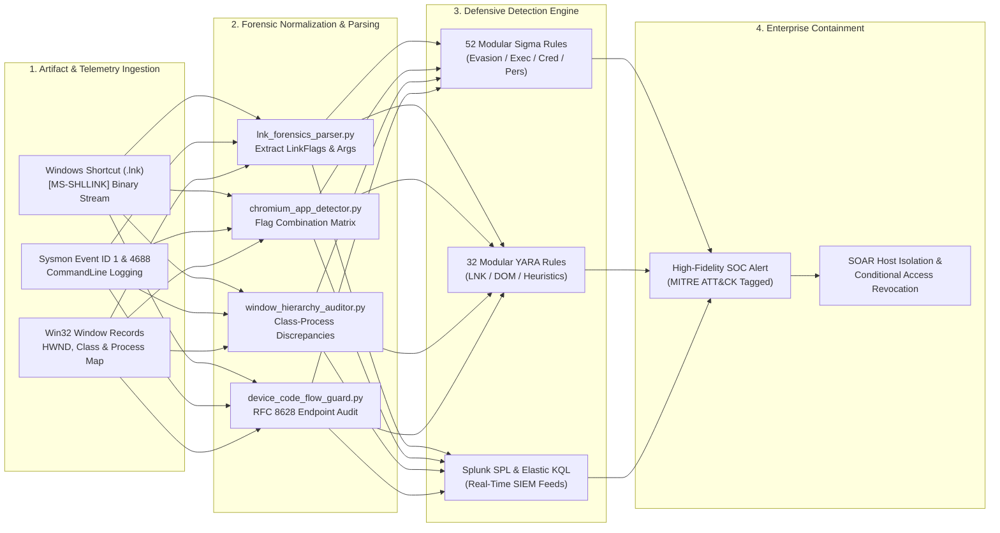

<div align="center">

<p align="center">
  <strong>🇺🇸 English</strong> · <a href="./docs/locales/ko.md">🇰🇷 한국어</a> · <a href="./docs/locales/zh-CN.md">🇨🇳 中文</a> · <a href="./docs/locales/es.md">🇪🇸 Español</a> · <a href="./docs/locales/hi.md">🇮🇳 हिन्दी</a><br />
  <a href="./docs/locales/ar.md">🇸🇦 العربية</a> · <a href="./docs/locales/pt-BR.md">🇧🇷 Português</a> · <a href="./docs/locales/ru.md">🇷🇺 Русский</a> · <a href="./docs/locales/fr.md">🇫🇷 Français</a> · <a href="./docs/locales/id.md">🇮🇩 Bahasa Indonesia</a>
</p>

<p align="center">
  <a href="https://github.com/maya-thorne/chromium-app-spoofing-forensics"></a>
</p>

# 🛡️ chromium-app-spoofing-forensics

**Blue Team EDR/SIEM Detection Engineering, 52 Sigma Rules, 32 YARA Signatures, [MS-SHLLINK] Binary Carving & Window Class Masquerading Framework**

[](https://github.com/maya-thorne/chromium-app-spoofing-forensics/releases/latest)
[](./rules/sigma)
[](./rules/yara)
[](./rules/siem_queries)
[](./docs/MITRE_ATTACK_DEFENSE_MATRIX.md)
[](./tests)
[](./LICENSE)

<sub>Engineered &amp; Audited by **[Maya Thorne](https://github.com/maya-thorne)** · Systems &amp; Detection Engineering Research</sub>

</div>

---

## 📌 Executive Overview

Chromium-based web browsers (Google Chrome, Microsoft Edge, Brave, Opera) feature a built-in application mode switch: `--app=<URL|Path>`. While engineered for Progressive Web Applications (PWAs), this switch strips away the entire browser chrome—including the Omnibox (address bar), SSL certificate padlock badge, extension indicators, and tab strips.

Adversaries weaponize this feature by dropping Windows shortcuts (`.lnk`) configured with legitimate corporate application icons (Microsoft Teams, OneDrive, Outlook). When executed, the browser loads a local or remote credential harvesting portal styled with pixel-accurate cloud identity layouts, deceiving enterprise users into perceiving the window as a trusted operating system software dialog.

This repository delivers an **enterprise-grade defensive engineering and forensic analysis suite**:
1. **Zero-Dependency Python Forensic Suite (`src/`)**: Pure-Python [MS-SHLLINK] binary parser, Chromium `--app` parameter detector, Win32 window hierarchy auditor, and OAuth Device Code Flow guard.
2. **52 Modular Production Sigma Rules (`rules/sigma/`)**: Defense Evasion (20), Execution (12), Credential Access (12), and Persistence (8) mapped to Sysmon Event ID 1, 11, and Security Event 4688.
3. **32 Modular YARA Signatures (`rules/yara/`)**: Granular byte rules targeting LNK shortcut anomalies (12), interface spoofing DOM patterns (10), and C# WebView2 wrappers (10).
4. **Turnkey SIEM Query Feeds (`rules/siem_queries/`)**: Production Splunk SPL and Elasticsearch Kibana KQL feeds for instantaneous SOC dashboard deployment.
5. **MITRE ATT&CK Enterprise Matrix**: Formal mappings across T1036.005, T1204.002, T1566.002, and T1528 in [`docs/MITRE_ATTACK_DEFENSE_MATRIX.md`](./docs/MITRE_ATTACK_DEFENSE_MATRIX.md).

---

## 🏛️ System Architecture & Forensics Topology

<p align="center">
  <a href="https://github.com/maya-thorne/chromium-app-spoofing-forensics"></a>
</p>



---

## 🏗️ Blue Team EDR/SIEM Detection Pipeline

<p align="center">
  <a href="https://github.com/maya-thorne/chromium-app-spoofing-forensics"></a>
</p>

---

## 💻 Interactive Forensic Terminal Live Demo

<p align="center">
  <a href="https://github.com/maya-thorne/chromium-app-spoofing-forensics"></a>
</p>

---

## 📚 Core Research Whitepapers

<table width="100%">
  <thead>
    <tr>
      <th width="32%">Research Document</th>
      <th width="68%">Technical Scope &amp; Target Systems</th>
    </tr>
  </thead>
  <tbody>
    <tr>
      <td>
        🔬 <strong><a href="./docs/whitepapers/01_CHROMIUM_APP_MODE_INTERFACE_SPOOFING.md">01_CHROMIUM_APP_MODE_INTERFACE_SPOOFING.md</a></strong>
      </td>
      <td>
        Chromium <code>--app</code> architecture, Omnibox stripping mechanics, <code>-incognito</code> session cache evasion, and modal window geometry mimicry.
      </td>
    </tr>
    <tr>
      <td>
        🔬 <strong><a href="./docs/whitepapers/02_LNK_BINARY_EXTRACTION_AND_FORENSICS.md">02_LNK_BINARY_EXTRACTION_AND_FORENSICS.md</a></strong>
      </td>
      <td>
        <code>[MS-SHLLINK]</code> binary format specifications, LinkFlags dissection, ExtraData block carving, and IconLocation masquerading.
      </td>
    </tr>
    <tr>
      <td>
        🔬 <strong><a href="./docs/whitepapers/03_NATIVE_WRAPPER_AND_AITM_CONVERGENCE.md">03_NATIVE_WRAPPER_AND_AITM_CONVERGENCE.md</a></strong>
      </td>
      <td>
        Microsoft Edge WebView2 C# wrappers, RFC 8628 OAuth Device Code Flow abuse, and Evilginx3/Modlishka AiTM reverse-proxy session cookie interception.
      </td>
    </tr>
    <tr>
      <td>
        🔬 <strong><a href="./docs/whitepapers/04_EDR_TELEMETRY_AND_DEFENSE_ARCHITECTURE.md">04_EDR_TELEMETRY_AND_DEFENSE_ARCHITECTURE.md</a></strong>
      </td>
      <td>
        Sysmon Event ID 1 &amp; 4688 correlation, Win32 window hierarchy auditing (Chrome_WidgetWin_1 vs TeamsWebView), and FIDO2 cryptographic origin binding.
      </td>
    </tr>
  </tbody>
</table>

---

## 🛡️ Rule Suite Architecture (52 Sigma & 32 YARA)

### 1. Modular Sigma Rules Breakdown (`rules/sigma/`)
- 📁 **[defense_evasion/](./rules/sigma/defense_evasion/) (20 Rules)**:
  - `--app=` flag invocation (`proc_creation_win_chromium_app_mode_flag.yml`)
  - Local HTML file hosting in app mode (`proc_creation_win_chromium_app_local_file.yml`)
  - Incognito session isolation evasion (`proc_creation_win_chromium_app_incognito.yml`)
  - App mode targeting Temp or AppData (`proc_creation_win_chromium_app_temp_dir.yml`)
  - Login modal dimension mimicry (`proc_creation_win_chromium_app_window_size.yml`)
  - Kiosk full-screen desktop hijack (`proc_creation_win_chromium_app_kiosk_evasion.yml`)
  - Isolated user-data-dir execution, UNC network share hosting, and LNK shortcut drops.
- 📁 **[execution/](./rules/sigma/execution/) (12 Rules)**:
  - Scripting hosts spawning Chromium (`powershell.exe`, `cmd.exe`, `wscript.exe`, `cscript.exe`)
  - Office child process spawning browser app mode (`winword.exe`, `excel.exe`)
  - Masquerading processes spawned under Teams parent trees.
- 📁 **[credential_access/](./rules/sigma/credential_access/) (12 Rules)**:
  - OAuth 2.0 Device Code Authorization endpoint targeting (`microsoft.com/devicelogin`)
  - Synthetic address bar injection and fake login portal initiation.
- 📁 **[persistence/](./rules/sigma/persistence/) (8 Rules)**:
  - URI scheme protocol handler hijacking (`msteams://`, `slack://`)
  - Disguised LNK drops in Startup directory and Registry Run key additions.

### 2. Modular YARA Rules Breakdown (`rules/yara/`)
- 📁 **[lnk_spoofing/](./rules/yara/lnk_spoofing/) (12 Rules)**:
  - Binary LNK files containing `--app=`, `-incognito`, `-inprivate`, `teams.ico`, or `office.ico`.
- 📁 **[interface_spoofing/](./rules/yara/interface_spoofing/) (10 Rules)**:
  - HTML DOM classes matching `fake-address-bar`, draggable BITB window scripts, and fake lock icons.
- 📁 **[heuristics/](./rules/yara/heuristics/) (10 Rules)**:
  - .NET binaries embedding Microsoft Edge WebView2 controls, RFC 8628 device code harvesters, and AiTM session cookie interceptors.

---

## ⚡ Instant SIEM Query Deployment

### Splunk SPL Snippet (`rules/siem_queries/splunk_queries.spl`)
```spl
index=windows sourcetype="XmlWinEventLog:Microsoft-Windows-Sysmon/Operational" EventCode=1
| where match(CommandLine, "(?i)--app=")
| stats count, values(CommandLine) as CmdLines, values(ParentImage) as Parents by host, User, Image
| sort - count
```

### Elastic KQL Snippet (`rules/siem_queries/elastic_kql_queries.kql`)
```kql
process.command_line: *--app=* and process.name: (chrome.exe or msedge.exe or brave.exe or opera.exe)
```

---

## 💻 Zero-Dependency Python Toolchain Usage

```bash
# Analyze a Windows Shortcut (.lnk) artifact
python -m src.cli --lnk "references/poc_shortcuts/01_brave_app_youtube_incognito.lnk"

# Inspect a process execution command line
python -m src.cli --cli "brave.exe --app=C:\\Users\\user\\Desktop\\1.html -incognito"

# Inspect HTML or JavaScript payload for fake address bars or Device Code Flow
python -m src.cli --html "references/screen_captures/sample.html"

# Output structured JSON report for SIEM / SOAR pipeline ingestion
python -m src.cli --lnk "references/poc_shortcuts/03_brave_app_local_html_incognito.lnk" --json
```

---

## 🧪 Unit Test Suite Verification

Run the automated test suite verifying all 4 detection engines:

```bash
python -m unittest tests/test_suite.py -v
```

Expected output:
```
Ran 8 tests in 0.004s
OK
```

---

<div align="center">
  <sub>Licensed under the <strong><a href="./LICENSE">Maya Thorne Systems &amp; Security Research License (MT-SRL)</a></strong>.</sub>
</div>
