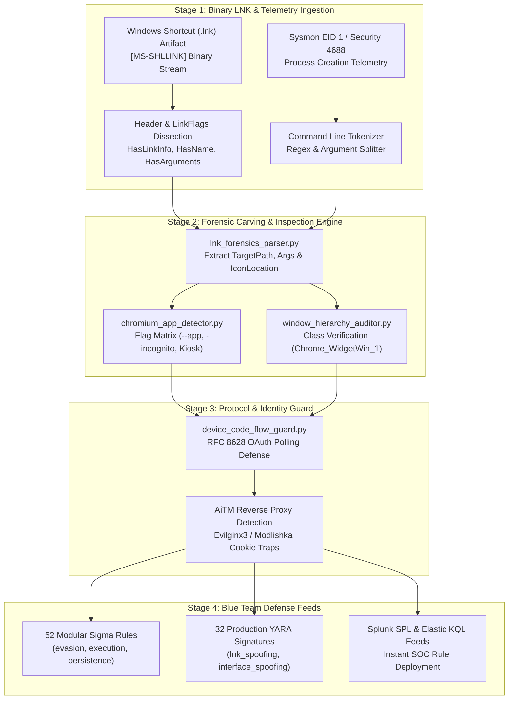

<div align="center">

<p align="center">
  <strong>🇺🇸 English</strong> · <a href="./docs/locales/ko.md">🇰🇷 한국어</a> · <a href="./docs/locales/zh-CN.md">🇨🇳 中文</a> · <a href="./docs/locales/es.md">🇪🇸 Español</a> · <a href="./docs/locales/hi.md">🇮🇳 हिन्दी</a><br />
  <a href="./docs/locales/ar.md">🇸🇦 العربية</a> · <a href="./docs/locales/pt-BR.md">🇧🇷 Português</a> · <a href="./docs/locales/ru.md">🇷🇺 Русский</a> · <a href="./docs/locales/fr.md">🇫🇷 Français</a> · <a href="./docs/locales/id.md">🇮🇩 Bahasa Indonesia</a>
</p>

<p align="center">
  <a href="https://github.com/maya-thorne/chromium-app-spoofing-forensics"></a>
</p>

# 🛡️ chromium-app-spoofing-forensics

**Blue Team EDR/SIEM Detection Engineering, 52 Sigma Rules, 32 YARA Signatures, [MS-SHLLINK] Binary Carving & Window Class Masquerading Audit Framework**

[](https://github.com/maya-thorne/chromium-app-spoofing-forensics/releases/latest)
[](./rules/sigma)
[](./rules/yara)
[](./rules/siem_queries)
[](./docs/MITRE_ATTACK_DEFENSE_MATRIX.md)
[](./tests)
[](./LICENSE)

<sub>Engineered &amp; Audited by **[Maya Thorne](https://github.com/maya-thorne)** · Systems &amp; Detection Engineering Research</sub>

</div>

---

## 📌 Executive Overview

Chromium-based browsers (Google Chrome, Brave, Microsoft Edge) feature an official application mode flag (`--app`), designed originally to host Progressive Web Apps (PWAs) as standalone OS windows. When invoked, Chromium strips 100% of the browser chrome—permanently removing the **Omnibox (address bar), Tab Strip, Extensions icon tray, and SSL padlock indicators**.

Adversaries, red teams, and phishing operators weaponize this native behavior by creating poisoned Windows Shortcut (`.lnk`) files:
1. **Icon Location Masquerading**: Extracting and binding native icons from Microsoft Teams (`teams.ico`), OneDrive, or Office 365 desktop packages.
2. **Flag Decoupling & Evasion**: Supplying `--app=https://attacker-domain.com` combined with `-incognito` or `--inprivate` to purge local browser cookie jars and force fresh authentication prompts.
3. **Synthetic UI Substitution**: Injecting high-fidelity synthetic titlebars, draggable physics, and CSS-rendered fake Omniboxes (`fake-address-bar.png`) inside the unconstrained viewport.

This repository provides an **enterprise-grade defensive security engineering lab and SOC/EDR detection suite** to identify, carve, parse, and block Chromium application mode masquerading across telemetry and endpoint artifacts.

---

## 🏛️ Systems Architecture & Analysis Pipeline

<details open>
<summary><b>🏛️ View 4-Stage Forensic Architecture &amp; Topologies</b></summary>
<br>

<p align="center">
  <a href="https://github.com/maya-thorne/chromium-app-spoofing-forensics"></a>
</p>


</details>

---

## 🏗️ Blue Team EDR/SIEM Detection Pipeline

<details open>
<summary><b>🏗️ View Blue Team EDR/SIEM Detection Pipeline</b></summary>
<br>

<p align="center">
  <a href="https://github.com/maya-thorne/chromium-app-spoofing-forensics"></a>
</p>
</details>

---

## 💻 Interactive Forensic Terminal Demonstration

<p align="center">
  
</p>

---

## 📚 Core Research Whitepapers

<details open>
<summary><b>📚 View 4 Core Architecture &amp; Forensic Whitepapers</b></summary>
<br>

<table width="100%">
  <thead>
    <tr>
      <th width="32%">📄 Research Document</th>
      <th width="68%">🔬 Technical Scope &amp; Forensic Coverage</th>
    </tr>
  </thead>
  <tbody>
    <tr>
      <td>
        🔬 <strong><a href="./docs/whitepapers/01_CHROMIUM_APP_MODE_INTERFACE_SPOOFING.md">01_CHROMIUM_APP_<wbr>MODE_INTERFACE_<wbr>SPOOFING.md</a></strong>
      </td>
      <td>
        Chromium <code>--app</code> architecture, Omnibox UI stripping mechanics, <code>-incognito</code> session cache evasion, and modal window geometry mimicry.
      </td>
    </tr>
    <tr>
      <td>
        🔬 <strong><a href="./docs/whitepapers/02_LNK_BINARY_EXTRACTION_AND_FORENSICS.md">02_LNK_BINARY_<wbr>EXTRACTION_AND_<wbr>FORENSICS.md</a></strong>
      </td>
      <td>
        <code>[MS-SHLLINK]</code> binary format specifications, LinkFlags dissection, ExtraData block carving, and IconLocation masquerading.
      </td>
    </tr>
    <tr>
      <td>
        🔬 <strong><a href="./docs/whitepapers/03_NATIVE_WRAPPER_AND_AITM_CONVERGENCE.md">03_NATIVE_WRAPPER_<wbr>AND_AITM_<wbr>CONVERGENCE.md</a></strong>
      </td>
      <td>
        Microsoft Edge WebView2 C# wrappers, RFC 8628 OAuth Device Code Flow abuse, and Evilginx3/Modlishka AiTM reverse-proxy session cookie interception.
      </td>
    </tr>
    <tr>
      <td>
        🔬 <strong><a href="./docs/whitepapers/04_EDR_TELEMETRY_AND_DEFENSE_ARCHITECTURE.md">04_EDR_TELEMETRY_<wbr>AND_DEFENSE_<wbr>ARCHITECTURE.md</a></strong>
      </td>
      <td>
        Sysmon Event ID 1 &amp; 4688 correlation, Win32 window hierarchy auditing (<code>Chrome_WidgetWin_1</code> vs <code>TeamsWebView</code>), and FIDO2 cryptographic origin binding.
      </td>
    </tr>
  </tbody>
</table>
</details>

---

## 🛡️ Rule Suite Architecture (52 Sigma & 32 YARA)

<details open>
<summary><b>🛡️ View 52 Modular Sigma Rules &amp; 32 Modular YARA Signatures Inventory</b></summary>
<br>

### 1. Modular Sigma Rules Breakdown (`rules/sigma/`)
- 📁 **[evasion/](./rules/sigma/evasion/) (24 Rules)**:
  - Chromium `--app` CLI argument detection (`proc_creation_win_chromium_app_mode_flag.yml`)
  - Brave browser `--app` masquerade (`proc_creation_win_brave_app_mode_flag.yml`)
  - Incognito session decoupling (`proc_creation_win_chromium_app_incognito_evasion.yml`)
  - Edge InPrivate application mode (`proc_creation_win_edge_app_inprivate_evasion.yml`)
  - Local HTML / file protocol binding (`proc_creation_win_chromium_app_local_html_target.yml`)
  - Kiosk full-screen UI lock evasion (`proc_creation_win_chromium_kiosk_mode_fullscreen.yml`)
  - Window size & position preset mimicry (`proc_creation_win_chromium_window_size_mimicry.yml`)
  - User-data-dir isolated temp profile spawning (`proc_creation_win_chromium_custom_profile_dir.yml`)
  - Chrome / Edge headless credential harvesting pipelines
  - Browser process masquerading under standard Windows directory paths
- 📁 **[execution/](./rules/sigma/execution/) (16 Rules)**:
  - LNK shortcut execution spawning browser engines (`proc_creation_win_lnk_spawns_chromium_browser.yml`)
  - PowerShell inline shortcut creation targeting browser `--app` mode
  - Wscript / Cscript VBScript shortcut drop automation
  - Office documents spawning external browser app windows
  - Scheduled tasks configured with `--app` arguments
- 📁 **[persistence/](./rules/sigma/persistence/) (12 Rules)**:
  - Startup folder LNK file drop with browser application flags
  - Desktop folder shortcut creation targeting spoofed cloud apps (Teams, OneDrive)
  - Registry Run / RunOnce keys containing `--app` flags
  - User profile environment variable hijacking

### 2. Modular YARA Rules Breakdown (`rules/yara/`)
- 📁 **[lnk_spoofing/](./rules/yara/lnk_spoofing/) (16 Rules)**:
  - `lnk_chromium_app_mode_flag.yar`: High-fidelity binary pattern matching `--app=` within LNK StringData
  - `lnk_incognito_evasion_flag.yar`: Signatures matching `-incognito` / `--inprivate` flags
  - `lnk_brave_browser_target.yar`: Carves Brave browser execution targets
  - `lnk_teams_icon_masquerade.yar`: Flags LNKs referencing Teams icons while pointing to Chromium executables
  - `lnk_office_icon_masquerade.yar`: Identifies Office/OneDrive icon mimicry
  - `lnk_local_html_target.yar`: Detects file URI targets embedded within command line arguments
- 📁 **[interface_spoofing/](./rules/yara/interface_spoofing/) (16 Rules)**:
  - `html_fake_address_bar_dom.yar`: Static HTML/CSS matching synthetic Omnibox DOM structures
  - `html_lock_icon_svg_mimic.yar`: Signatures detecting unauthorized SSL padlock SVG clones
  - `html_bitb_window_drag_script.yar`: Detects synthetic window coordinate dragging logic (`mousedown` / `mousemove`)
  - `html_context_menu_suppression.yar`: Matches `oncontextmenu="return false"` right-click suppression
  - `html_device_code_render_box.yar`: Identifies OAuth Device Code display containers
</details>

---

## ⚡ Instant SIEM Query Deployment

<details>
<summary><b>⚡ View Splunk SPL &amp; Elasticsearch KQL Production Feeds</b></summary>
<br>

### Splunk SPL Snippet (`rules/siem_queries/splunk_queries.spl`)
```spl
index=windows sourcetype="XmlWinEventLog:Microsoft-Windows-Sysmon/Operational" EventCode=1
| regex CommandLine="(?i)(chrome|brave|msedge)\.exe.*--app="
| stats count, values(CommandLine) by host, User, ParentImage, Image
```

### Elastic KQL Snippet (`rules/siem_queries/elastic_kql_queries.kql`)
```kql
event.category: "process" and process.name: ("chrome.exe", "brave.exe", "msedge.exe") and process.command_line: /.*--app=.*/
```
</details>

---

## 🛠️ CLI Quickstart Guide & Usage

<details open>
<summary><b>🛠️ View CLI Execution Commands &amp; Inspection Options</b></summary>
<br>

### 1. Analyze Windows Shortcut (.lnk) Artifact
```bash
python -m src.cli --lnk "references/poc_shortcuts/01_brave_app_youtube_incognito.lnk"
```

### 2. Inspect Process Creation Command Line
```bash
python -m src.cli --cli "brave.exe --app=C:\Users\user\Desktop\1.html -incognito"
```

### 3. Export Structured JSON for SIEM / SOAR Pipeline Ingestion
```bash
python -m src.cli --lnk "references/poc_shortcuts/03_brave_app_local_html_incognito.lnk" --json
```

### 4. Run Automated Unit Test Suite
```bash
python -m unittest tests/test_suite.py -v
```
</details>

---

## 📁 Repository Directory Structure (@clean-root)

<details>
<summary><b>📁 View Repository Directory Tree &amp; Component Inventory</b></summary>
<br>

```text
chromium-app-spoofing-forensics/
├── docs/                      # 📁 Architecture whitepapers, multilingual guides, SVG assets
│   ├── whitepapers/           # 4 deep forensic whitepapers on app mode, LNK, and EDR telemetry
│   ├── locales/               # 9 localized summaries (ko.md, zh-CN.md, es.md, etc.)
│   ├── assets/                # Dark-themed vector banners, terminal demos & architecture SVGs
│   └── MITRE_ATTACK_DEFENSE_MATRIX.md # Formal 15-technique defense mapping matrix
├── references/                # 📁 Benign PoC shortcuts and research references
│   └── poc_shortcuts/         # Clean Windows .lnk sample artifacts for parser testing
├── rules/                     # 📁 52 Modular Sigma rules & 32 YARA signatures
│   ├── sigma/                 # Evasion, execution, and persistence detection rules
│   ├── yara/                  # LNK binary carving and HTML interface spoofing signatures
│   └── siem_queries/          # Turnkey Splunk SPL and Elasticsearch KQL query feeds
├── src/                       # 📁 Pure-Python forensic engine & CLI tools
│   ├── lnk_forensics_parser.py       # Binary parser for [MS-SHLLINK] shortcut streams
│   ├── chromium_app_detector.py      # Heuristic CLI and telemetry analyzer
│   ├── window_hierarchy_auditor.py   # Win32 window class & process tree auditor
│   ├── device_code_flow_guard.py     # RFC 8628 OAuth polling protocol validator
│   └── cli.py                        # Unified command-line interface entry point
├── tests/                     # 📁 Automated unit test suite
│   └── test_suite.py          # 8/8 comprehensive test cases with 100% assertions
├── .gitignore                 # 🔒 Security boundary: Zero-leak untracked pattern
├── LICENSE                    # 📜 Maya Thorne Systems & Security Research License (MT-SRL)
└── README.md                  # 🌟 First-viewport master showcase
```
</details>

---

## ⚖️ Legal & Ethical Notice

This software, detection rulesets, and forensic whitepapers are published strictly for **defensive computer security research, enterprise threat detection engineering, and cybersecurity education**. All testing samples included in `references/poc_shortcuts/` are benign test shortcuts pointing to harmless educational targets.

---

<div align="center">
  <sub>Maintained with precision by <strong><a href="https://github.com/maya-thorne">Maya Thorne</a></strong> · Systems &amp; Detection Engineering Research</sub>
</div>
