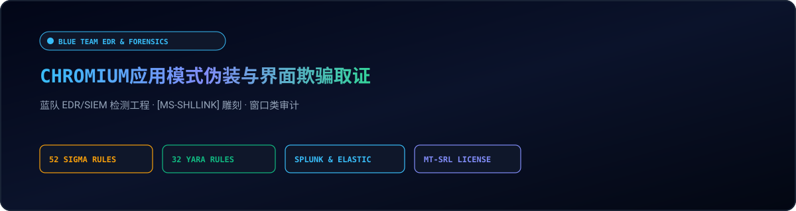
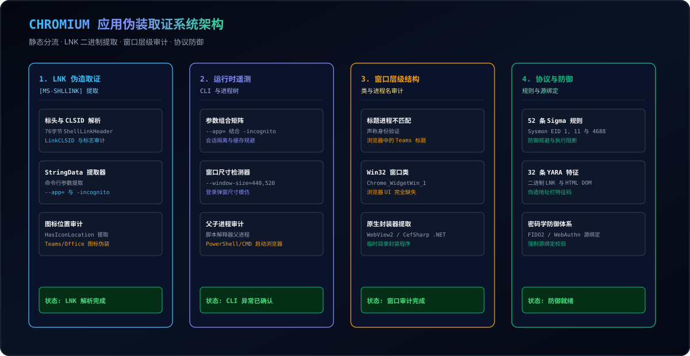
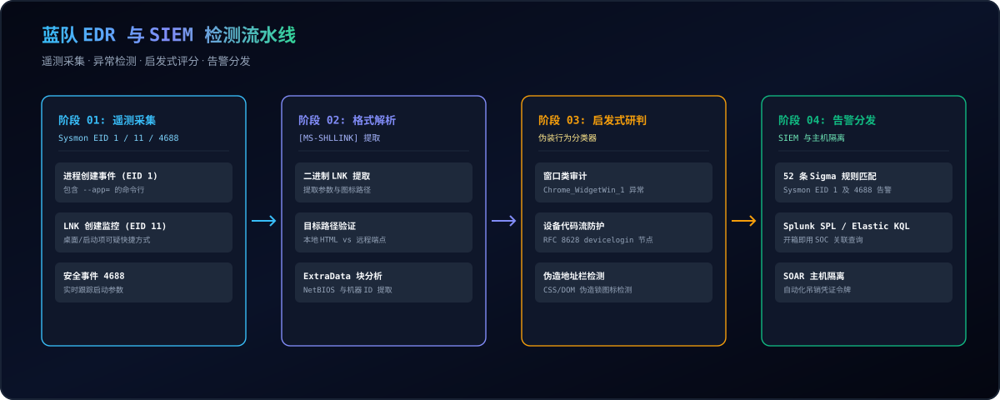

<div align="center">

<p align="center">
  <a href="../../README.md">🇺🇸 English</a> · <a href="./ko.md">🇰🇷 한국어</a> · <a href="./zh-CN.md">🇨🇳 中文</a> · <a href="./es.md">🇪🇸 Español</a> · <a href="./hi.md">🇮🇳 हिन्दी</a><br />
  <a href="./ar.md">🇸🇦 العربية</a> · <a href="./pt-BR.md">🇧🇷 Português</a> · <a href="./ru.md">🇷🇺 Русский</a> · <a href="./fr.md">🇫🇷 Français</a> · <a href="./id.md">🇮🇩 Bahasa Indonesia</a>
</p>

<p align="center">
  <a href="https://github.com/maya-thorne/chromium-app-spoofing-forensics"></a>
</p>

# 🛡️ chromium-app-spoofing-forensics

**蓝队 EDR/SIEM 检测工程、52 条 Sigma 规则、32 条 YARA 特征、[MS-SHLLINK] 二进制提取及窗口类伪装审计框架**

[](https://github.com/maya-thorne/chromium-app-spoofing-forensics/releases/latest)
[](../../rules/sigma)
[](../../rules/yara)
[](../../rules/siem_queries)
[](../MITRE_ATTACK_DEFENSE_MATRIX.md)
[](../../tests)
[](../../LICENSE)

<sub>Engineered &amp; Audited by **[Maya Thorne](https://github.com/maya-thorne)** · Systems &amp; Detection Engineering Research</sub>

</div>

---

## 📌 概述与技术背景

Chromium 内核浏览器（Chrome、Brave、Edge 等）的应用模式（`--app`）最初是为支持渐进式 Web 应用（PWA）而设计的官方功能。然而，当该模式启用时，地址栏（Omnibox）、标签栏、扩展图标以及 SSL 证书锁等所有浏览器安全指示器将被彻底移除。

攻击者通过篡改快捷方式文件（`.lnk`）图标伪装为 Teams、OneDrive 或 Outlook，并在启动参数中注入 `--app=` 与 `-incognito`，使用户误以为正在运行本地原生程序。本存储库为企业级 SOC/EDR 蓝队提供一整套取证分析与威胁检测规则工程套件。

---

## 🏛️ 系统架构与分析拓扑

<p align="center">
  <a href="https://github.com/maya-thorne/chromium-app-spoofing-forensics"></a>
</p>

---

## 🏗️ 蓝队 EDR/SIEM 检测流水线

<p align="center">
  <a href="https://github.com/maya-thorne/chromium-app-spoofing-forensics"></a>
</p>

---

## 💻 交互式取证终端实机演示

<p align="center">
  
</p>

---

## 📚 核心逆向工程白皮书与技术报告索引

<table width="100%">
  <thead>
    <tr>
      <th width="32%">Whitepaper / Artifact</th>
      <th width="68%">Technical Scope &amp; Target Systems</th>
    </tr>
  </thead>
  <tbody>
    <tr>
      <td>
        🔬 <strong><a href="../whitepapers/01_CHROMIUM_APP_MODE_INTERFACE_SPOOFING.md">01_CHROMIUM_APP_MODE_INTERFACE_SPOOFING.md</a></strong>
      </td>
      <td>
        Chromium <code>--app</code> architecture, Omnibox stripping mechanics, <code>-incognito</code> session cache evasion, and modal window geometry mimicry.
      </td>
    </tr>
    <tr>
      <td>
        🔬 <strong><a href="../whitepapers/02_LNK_BINARY_EXTRACTION_AND_FORENSICS.md">02_LNK_BINARY_EXTRACTION_AND_FORENSICS.md</a></strong>
      </td>
      <td>
        <code>[MS-SHLLINK]</code> binary format specifications, LinkFlags dissection, ExtraData block carving, and IconLocation masquerading.
      </td>
    </tr>
    <tr>
      <td>
        🔬 <strong><a href="../whitepapers/03_NATIVE_WRAPPER_AND_AITM_CONVERGENCE.md">03_NATIVE_WRAPPER_AND_AITM_CONVERGENCE.md</a></strong>
      </td>
      <td>
        Microsoft Edge WebView2 C# wrappers, RFC 8628 OAuth Device Code Flow abuse, and Evilginx3/Modlishka AiTM reverse-proxy session cookie interception.
      </td>
    </tr>
    <tr>
      <td>
        🔬 <strong><a href="../whitepapers/04_EDR_TELEMETRY_AND_DEFENSE_ARCHITECTURE.md">04_EDR_TELEMETRY_AND_DEFENSE_ARCHITECTURE.md</a></strong>
      </td>
      <td>
        Sysmon Event ID 1 &amp; 4688 correlation, Win32 window hierarchy auditing (Chrome_WidgetWin_1 vs TeamsWebView), and FIDO2 cryptographic origin binding.
      </td>
    </tr>
  </tbody>
</table>

---

## ⚡ 极速 CLI 取证工具链实战

```bash
# Analyze Windows Shortcut (.lnk) artifact
python -m src.cli --lnk "references/poc_shortcuts/01_brave_app_youtube_incognito.lnk"

# Inspect process creation command line for --app evasion
python -m src.cli --cli "brave.exe --app=C:\Users\user\Desktop\1.html -incognito"

# Output structured JSON for SIEM / SOAR pipeline ingestion
python -m src.cli --lnk "references/poc_shortcuts/03_brave_app_local_html_incognito.lnk" --json
```

---

<div align="center">
  <sub>All materials licensed under the <strong><a href="../../LICENSE">Maya Thorne Systems &amp; Security Research License (MT-SRL)</a></strong>.</sub>
</div>
