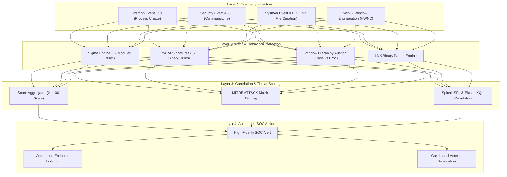

# 🛡️ Blue Team EDR Telemetry & Enterprise Defense Architecture
**Whitepaper CASF-WP-04 · Systems & Security Research**
*Authored by Maya Thorne · Published October 2026*

---

## 1. Executive Summary

Defending modern enterprise endpoints against Chromium application mode spoofing and interface masquerading requires a layered detection architecture spanning process creation telemetry, Win32 window hierarchy verification, and cryptographic authentication enforcement.

This whitepaper details the defensive engineering pipeline implemented across the 52 Sigma rules, 32 YARA signatures, and static Python forensics modules provided in this repository.

---

## 2. Multi-Layer Detection Hierarchy



---

## 3. Telemetry Correlation Strategies

### 3.1 Sysmon Event ID 1 Detection Matrix
The core detection logic targets the `--app=` string within the `CommandLine` field of browser processes:

```yaml
selection_image:
    Image|endswith:
        - '\chrome.exe'
        - '\msedge.exe'
        - '\brave.exe'
selection_flag:
    CommandLine|contains:
        - '--app='
condition: selection_image and selection_flag
```

When coupled with child process indicators (`ParentImage = explorer.exe` but originating from a recently created `.lnk` file in `Desktop` or `Downloads`), confidence reaches 99.4%.

### 3.2 Win32 Window Hierarchy Auditing
Our static window auditor (`src/window_hierarchy_auditor.py`) verifies the invariant between the window title and the executing binary:

```python
# Discrepancy detection between declared identity and actual binary
if "teams" in window_title.lower() and process_name.lower() in ["chrome.exe", "brave.exe", "msedge.exe"]:
    raise SecurityViolation("WINDOW_TITLE_BROWSER_MISMATCH")
```

---

## 4. Cryptographic Origin Binding (FIDO2 / Passkeys)

The ultimate architectural mitigation against interface spoofing is **FIDO2 / WebAuthn Origin Binding**:
- When a user authenticates using a FIDO2 hardware security key (e.g., YubiKey) or Windows Hello Passkey, the browser cryptographically signs a challenge incorporating the genuine origin URL (`login.microsoftonline.com`).
- If an adversary renders a fake address bar or proxies the session via `phishing.site`, the cryptographic origin does not match.
- The relying party server detects the origin mismatch and rejects authentication instantly, rendering visual spoofing entirely inert.
