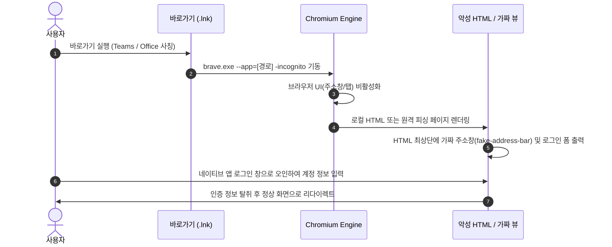

# Chromium `--app` 모드 기반 데스크톱 앱 위장 및 고도화 공격 기법 분석 보고서

## 📋 개요 (Executive Summary)

본 문서는 `apps & http 해킹 기법` 디렉터리에 포함된 PoC 및 연구 자료를 바탕으로, **Chromium 브라우저의 애플리케이션 모드(`--app`)를 악용한 네이티브 프로그램 위장 메커니즘**과 이를 한 단계 더 발전시킨 **고도화된 최신 위장·우회 기법(BITB, WebView2 인젝션, Device Code Phishing, AiTM 연계 등)**을 심층적으로 분석하고 체계화한 엔지니어링 기술 보고서입니다.

---

## 1. ⚙️ 기본 기법: Chromium `--app` 모드의 원리와 구조

### 1.1 Chromium `--app` 플래그의 본래 목적
Chromium 기반 브라우저(Chrome, Brave, Edge 등)의 `--app` 플래그는 본래 **프로그레시브 웹 앱(PWA)**이나 특정 웹 서비스를 데스크톱 네이티브 애플리케이션처럼 독립된 창에서 실행할 수 있도록 지원하는 공식 기능입니다.

```bash
# 기본 실행 문법
brave.exe --app=https://example.com
brave.exe --app=C:\Users\user\Desktop\target.html -incognito
```

### 1.2 브라우저 크롬(Chrome UI) 제거 메커니즘
`--app` 플래그가 전달되면 브라우저는 표준 브라우징 모드와 전혀 다른 렌더링 파이프라인을 가동합니다:

```
[일반 브라우징 모드]
┌────────────────────────────────────────────────────────┐
│ [Tab 1] [Tab 2] [+]                           [-] [x]  │ ➔ Tab Strip
├────────────────────────────────────────────────────────┤
│ [←] [→] [↻]  🔒 https://real-site.com          [★] [🧩] │ ➔ Omnibox (주소창)
├────────────────────────────────────────────────────────┤
│ [북마크 1] [북마크 2] [북마크 3]                         │ ➔ Bookmarks Bar
├────────────────────────────────────────────────────────┤
│                                                        │
│                    웹 뷰 렌더링 영역                    │
│                                                        │
└────────────────────────────────────────────────────────┘

                        ▼  --app 플래그 적용 시

[--app 모드 (App Window)]
┌────────────────────────────────────────────────────────┐
│ 🪟 Title (HTML <title> 값 표시)                 [-] [x]  │ ➔ OS 타이틀바만 유지
├────────────────────────────────────────────────────────┤
│                                                        │
│                                                        │
│                    웹 뷰 렌더링 영역                    │
│             (주소창, 탭, 북마크, 확장 UI 0% 노출)        │
│                                                        │
│                                                        │
└────────────────────────────────────────────────────────┘
```

1. **Omnibox(주소창) 및 보안 표시 제거**: 현재 로드된 도메인(`http`, `file:///`), SSL 인증서 자물쇠, 경고 표시가 완전히 가려집니다.
2. **탭 표시줄(Tab Strip) 비활성화**: 다중 탭 기능이 차단되어 사용자가 다른 페이지로 이동하거나 탭을 닫는 브라우저식 제어를 인지하지 못합니다.
3. **확장 프로그램(Extension) 아이콘 은닉**: 피싱 방지 확장 도구나 비밀번호 관리자 아이콘의 시각적 피드백이 차단됩니다.
4. **`-incognito` 결합 효과**: 기존 브라우저 프로필의 쿠키, 자동 완성, 브라우징 히스토리를 타지 않는 임시 인스턴스로 생성되어, 언제나 로그인하지 않은 백지 폼을 강제 노출시킵니다.

---

## 2. 🎯 메커니즘 3단계 분해 (실행 흐름)



### 단계 1: 실행 및 윈도우 컨텍스트 위장
- 공격자는 바로가기 파일(`.lnk`)의 아이콘을 Microsoft Teams(`teams.ico`), Word, OneDrive 등의 공식 리소스로 변경합니다.
- 대상 실행 경로를 `brave.exe --app=...`로 설정하여 사용자가 더블 클릭 시 일반 데스크톱 프로그램이 실행된 것으로 신뢰하게 만듭니다.

### 단계 2: 뷰포트 내 가짜 UI 렌더링 (mr.d0x 기법)
- 브라우저 상단 주소창이 제거되었으므로, 웹 뷰 렌더링 영역 최상단에 CSS로 가짜 주소창(`fake-address-bar.png`)을 직접 그려 넣습니다.
- 녹색/회색 자물쇠 아이콘, `https://microsoft.com/login` 텍스트, 복사 버튼 등을 고해상도로 렌더링하여 브라우저 주소창이 정상적으로 존재하는 것처럼 착각을 유도합니다.

### 단계 3: 픽셀 단위 로그인 모달 모사 (`teams.png`, `login-fake.png`)
- Microsoft 계정 로그인 창의 정확한 가로/세로 규격(예: 440px × 520px), 시스템 폰트(`Segoe UI`), 여백(Margin/Padding), 색상 코드, SVG 로고를 1:1로 일치시킵니다.
- Windows의 타이틀바 테마(다크 모드 / 라이트 모드)와 창 닫기 버튼 색상까지 일치시켜 OS 네이티브 팝업과의 구분을 불가능하게 만듭니다.

---

## 3. 🚀 고도화된 연계 및 발전 기법 (Advanced Attack Vectors)

기본 `--app` 모드는 프로세스 목록에 `brave.exe`나 `chrome.exe`가 노출되는 한계가 있습니다. 현대 보안 환경에서는 이를 뛰어넘는 다음과 같은 고도화 기법들이 연구·실증되고 있습니다.

---

### 기법 1. Browser-in-the-Browser (BITB) 완전 가상화
- **원리**: 브라우저 창 내부에 HTML/CSS/JS로 완벽한 가짜 OS 창(Windows/macOS 타이틀바, 창 조작 버튼, 가짜 URL 주소창)을 띄우는 기법.
- **고도화 포인트**:
  - **창 드래그 & 이동 시뮬레이션**: 웹페이지 내부의 가짜 팝업을 마우스로 잡고 드래그하면 실제 OS 창처럼 자유롭게 이동.
  - **OS 테마 실시간 동기화**: `window.matchMedia('(prefers-color-scheme: dark)')`를 조회하여 사용자의 윈도우 테마에 맞추어 타이틀바 색상을 즉시 변경.
  - **진짜 도메인 표시 눈속임**: 가짜 주소창에 `login.microsoftonline.com`이나 `accounts.google.com`을 정적으로 고정 표기하여 URL 검증을 무력화.

---

### 기법 2. WebView2 / CefSharp 네이티브 래퍼 주입 (Native Wrapper Spoofing)
- **원리**: Chromium 브라우저를 직접 띄우는 대신, 50KB 내외의 초경량 C# WinForms/WPF 바이너리를 제작하여 Microsoft Edge WebView2 컨트롤을 임베딩.
- **고도화 포인트**:
  - **프로세스명 스푸핑**: 실행 파일 이름 자체를 `Teams.exe` 또는 `ms-teams.exe`로 생성하여 작업 관리자에서 완벽한 네이티브 앱으로 위장.
  - **주소창 원천 부재**: 브라우저 기반이 아닌 순수 Win32 창 프레임이므로 어떠한 브라우저 아티팩트도 남지 않음.
  - **CDP(Chrome DevTools Protocol) 직접 제어**: 임베디드 런타임에 직접 CDP 명령을 주입하여 사용자가 타이핑하는 키로깅, 메모리 내 쿠키 및 토큰을 실시간 추출.

```csharp
// WebView2 기반 무주소창 네이티브 위장 예시 구조
public class FakeAppForm : Form {
    private Microsoft.Web.WebView2.WinForms.WebView2 webView;
    public FakeAppForm() {
        this.Text = "Sign in to Microsoft Teams";
        this.Size = new Size(480, 640);
        this.FormBorderStyle = FormBorderStyle.FixedDialog; // 네이티브 다이얼로그 외형
        this.Icon = Icon.ExtractAssociatedIcon(@"C:\Path\To\real_teams.ico");

        webView = new Microsoft.Web.WebView2.WinForms.WebView2 { Dock = DockStyle.Fill };
        this.Controls.Add(webView);
        webView.EnsureCoreWebView2Async().ContinueWith(task => {
            webView.CoreWebView2.Navigate("https://phishing-endpoint.internal/login");
        });
    }
}
```

---

### 기법 3. OAuth 2.0 디바이스 코드 흐름 피싱 (Device Code Flow Abuse)
- **원리**: 사용자의 비밀번호를 직접 가짜 폼으로 입력받지 않고, 정식 Microsoft OAuth 인증 흐름을 가로채는 방식.
- **고도화 포인트**:
  - 가짜 앱 창에서 `https://microsoft.com/devicelogin`으로 연결을 유도하며 8자리 디바이스 코드(예: `B4X9-K2L8`)를 화면에 표시.
  - 사용자는 실제 `microsoft.com` 도메인에서 자신의 정상 브라우저로 2단계 인증(2FA/MFA)까지 직접 통과함.
  - 사용자가 인증을 완료하는 순간, 공격자의 백그라운드 세션에 Azure AD/Office 365의 강력한 OAuth Refresh Token이 발급됨.
  - **결과**: 비밀번호 수집 없이 MFA와 FIDO2 보안키를 완벽히 우회하여 세션 탈취.

---

### 기법 4. 커스텀 프로토콜 핸들러 악용 (Protocol Handler Hijacking)
- **원리**: 윈도우 레지스트리에 등록된 `msteams://`, `slack://`, `zoommtg://` 프로토콜을 가로채거나 가짜 프로토콜을 등록.
- **메커니즘**:
  - 웹 브라우저에서 `msteams:/meeting/...` 링크를 클릭했을 때 진짜 Teams가 아닌 악성 래퍼가 실행되도록 레지스트리 `HKCU\Software\Classes\msteams`를 조작.
  - 세션 만료 모달을 띄워 재로그인을 유도.

---

### 기법 5. Adversary-in-the-Middle (AiTM) 프록시 엔진 결합
- **원리**: 정적 HTML 화면 대신, 백엔드에 Evilginx3 / Modlishka와 같은 리버스 프록시를 배치.
- **메커니즘**:
  - 가짜 앱 창이 실제 Microsoft/Google 로그인 서버를 실시간으로 중계(Mirroring).
  - 1회성 2FA 인증번호(TOTP), SMS 번호, 심지어 모바일 번호 매칭 팝업까지 실시간으로 통과.
  - 최종 인증 완료 후 발급되는 핵심 세션 쿠키(`ESTSAUTH`, `ESTSAUTHPERSISTENT`, `SSID`)를 가로채어 공격자 브라우저에 주입, 무인증 영구 세션 장악.

---

## 4. 🛡️ 탐지 엔지니어링 및 보안 아키텍처 (Detection & Defense)

| 분석 계층 | 탐지 및 차단 기법 | 기술적 세부사항 |
| :--- | :--- | :--- |
| **명령줄 감사<br>(Process CLI)** | `--app=` 플래그 모니터링 | Sysmon Event ID 1 또는 EDR에서 `CommandLine` 필드에 `--app=` 및 로컬 경로(`file:///`, `.html`)가 포함된 브라우저 기동 탐지. |
| **프로세스 계층 트리<br>(Process Hierarchy)** | 부모-자식 관계 이상 탐지 | 일반적인 Office/Teams는 `explorer.exe` ➔ `Teams.exe`로 실행되나, 본 기법은 `explorer.exe` ➔ `brave.exe/chrome.exe`로 파생되는 비정상 구조 식별. |
| **윈도우 핸들(HWND) 분석** | Win32 Window Class 검증 | 실제 Teams는 `TeamsWebView` 또는 Electron 창 클래스를 사용하나, 위장 창은 `Chrome_WidgetWin_1` 클래스를 가짐. |
| **FIDO2 / WebAuthn 방어** | 오리진 바인딩(Origin Binding) | FIDO2 하드웨어 보안키 및 패스키(Passkey)는 브라우저가 제공하는 암호학적 Origin 도메인을 검증하므로, 가짜 화면이나 피싱 도메인에서는 서명 생성이 원천 차단됨. |

---

## 5. 📑 요약 및 결론

1. **본질**: 본 디렉터리의 자료는 브라우저의 기본 기능인 `--app`을 영리하게 전용하여 **보안 주소창을 제거하고 네이티브 데스크톱 앱 화면을 픽셀 단위로 모사**하는 인터페이스 스푸핑 기법입니다.
2. **진화 방향**: 단순 바로가기(`.lnk`) 실행에서 출발하여 ➔ **WebView2 독립 실행 파일 래핑** ➔ **Device Code Flow 기반 MFA 우회** ➔ **AiTM 실시간 리버스 프록시 연계**로 지속적으로 고도화되고 있습니다.
3. **핵심 가치**: 이러한 원리를 정확히 이해함으로써 피싱 시뮬레이션, 사용자 인터페이스 무결성 감사, EDR 탐지 룰(Sigma/YARA) 설계에 직접적인 엔지니어링 통찰을 제공합니다.
